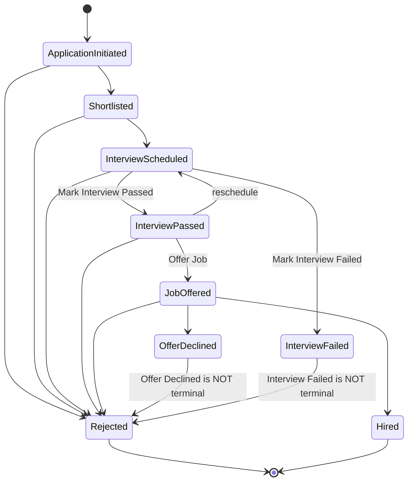

# BUSINESS REQUIREMENTS DOCUMENT (BRD/PRD) — RECRUITMENT MODULE

### AS-IS specification — reverse-engineered through automated testing (Playwright) on the real system

| Field | Value |
|---|---|
| **Reference system** | OrangeHRM OS Demo — https://opensource-demo.orangehrmlive.com/web/index.php/ (OS 5.9) |
| **Document version** | v6.4 |
| **Verification date** | 11 July 2026 |
| **Method** | UI automation + network response verification (HTTP status and actual error messages) for all create/update/delete actions — no assumptions |
| **Status** | **100% of business items verified — no remaining gaps** |

**Version history:** v3.0 verified Vacancy deletion, Attachments, and Interview Passed/Failed → v4.0 verified the complete pipeline through Hired and corrected the Hiring Manager rule → v5.0 closed gaps in permissions, Offer Declined, and Number of Positions → v6.0 closed the decimal validation gap and shortened the document → v6.1 closed the last gap (actions after Interview Failed) → v6.2 combined Actors and Permissions, and removed misleading sequential arrows from the status list → v6.3 added exact validation messages (email format, resume file type/size) and the yyyy-dd-mm date format, based on a cross-check against an independent `plan-tcs` Mode B run (which did not read this document) that revealed facts missing from the original BRD → **v6.4** identified the actual root cause of HTTP 500 errors found during earlier verification attempts (Rule #21: the Vacancy had no Hiring Manager; it was NOT random backend downtime). The remaining four states (Interview Passed, Job Offered, Offer Declined, Hired) were directly verified by switching to a Vacancy with a valid Hiring Manager.

> Every behavior marked "verified" is supported by a direct network response and/or screenshot. The environment is a shared public demo. The backend can sometimes return temporary HTTP 500 errors on data-changing actions; these cases are documented rather than ignored.

---

## 1. PURPOSE

This document is an AS-IS specification reconstructed from real system behavior (there was no original BRD). It serves as the **ground truth for test case planning**. Each user story has an identifier (`REC-1xx`, etc.) for traceability when generating test cases. Section 8 (Business Rules) is the main source for negative and edge cases. Section 9 (Out of Scope / Features That Do Not Exist) lists behaviors that may seem likely but do not exist in the actual system, helping prevent AI or QA from generating tests for nonexistent features.

---

## 2. SCOPE

The module has two tabs: **Candidates** and **Vacancies**. There is no separate Dashboard or Kanban board.

Fully verified: Vacancy CRUD (including Attachments), Candidate CRUD, Public Apply Form, all **8/8 stage actions** in the Candidate Pipeline, and hidden business rules (unique/required constraints, duplicate checks, field locking, overlapping schedule validation, and permissions).

---

## 3. GLOSSARY

| Term | Definition |
|---|---|
| Vacancy | A job opening linked to one Job Title and one Hiring Manager; it may be published publicly. |
| Job Title | A shared job-title value referenced from Admin > Job Titles. |
| Hiring Manager / Interviewer | Data fields referencing an **Employee** — **not system roles** (see Section 4). |
| Candidate | An applicant record that moves through the Candidate Pipeline according to its status. |
| Candidate Pipeline | The set of statuses for a candidate. Only `Rejected` and `Hired` are truly terminal; `Offer Declined` and `Interview Failed` are NOT terminal, since `Reject` remains available. |
| Stage Action | An action that changes status (Shortlist, Reject, etc.). It always opens a form with Candidate/Vacancy/Hiring Manager/Current Status/Notes and Cancel/Save. |
| ESS | Employee Self Service — one of the two system roles; it has no access to Recruitment. |

---

## 4. ACTORS & PERMISSIONS

The system has only two roles (Admin > User Management > Add User): `Admin` and `ESS`. **There are no "Hiring Manager" or "Interviewer" system roles.** The corresponding fields on the Vacancy/Schedule Interview forms reference Employees and are unrelated to account permissions.

| Actor | Permissions |
|---|---|
| `Admin` role | Full access to Recruitment: Vacancy/Candidate CRUD and all stage actions. |
| `ESS` role | NO access to Recruitment, blocked both at the menu and route level (direct URL access displays "Credential Required"). |
| Candidate (public visitor, not logged in) | Can view jobs.html and submit an application through the Public Apply Form. |

*(For detailed evidence, see REC-501 and REC-502 in Section 6.)* When generating permission test cases, use only the two real roles, Admin and ESS. Do not generate a test case for "logging in as Hiring Manager".

---

## 5. CANDIDATE PIPELINE

### 5.1. Status list (9 statuses, in dropdown order — NOT a fixed sequential workflow; see the actual flow in Section 5.3)

`Application Initiated`, `Shortlisted`, `Rejected`, `Interview Scheduled`, `Interview Passed`, `Interview Failed`, `Job Offered`, `Offer Declined`, `Hired`

### 5.2. Available actions by current status

| Current status | Available actions |
|---|---|
| Application Initiated | `Shortlist`, `Reject` |
| Shortlisted | `Schedule Interview`, `Reject` |
| Interview Scheduled | `Reject`, `Mark Interview Failed`, `Mark Interview Passed` |
| Interview Passed | `Reject`, `Schedule Interview` (reschedule), `Offer Job` |
| Interview Failed | `Reject` — **not a terminal state** |
| Job Offered | `Reject`, `Offer Declined`, `Hire` |
| Offer Declined | `Reject` — **not a terminal state** |
| Hired | *(No actions)* — a truly terminal state |

### 5.3. State diagram (actual branching flow)



---

## 6. USER STORIES

### Vacancy

#### REC-101: Vacancy List

```gherkin
Given Recruitment > Vacancies
Then the page includes filters (Job Title, Vacancy, Hiring Manager, Status), an Add button,
     and a table (Vacancy, Job Title, Hiring Manager, Status, Actions)
And there is NO Total Candidates / Active-Applied count column or View Candidates button
```

#### REC-102: Create Vacancy

```gherkin
Given Recruitment > Vacancies > Add
Then the form includes Vacancy Name*, Job Title*, Description, Hiring Manager*, Number of Positions,
     an Active toggle, and a "Publish in RSS Feed and Web Page" toggle
     (when enabled, RSS Feed URL and Web Page URL are displayed,
     e.g., .../recruitmentApply/jobs.rss and /jobs.html)
And Vacancy Name MUST be unique — a duplicate, including an inactive Vacancy, shows "Already exists"
And Hiring Manager is required and must be selected from Employee autocomplete suggestions;
     typing a name without selecting a suggestion shows "Invalid" (not "Required")
And Number of Positions is optional, but if filled in, it must be an INTEGER from 1 to 99
     - letters, negative numbers, or decimals (e.g., "abc", "-5", "1.5") show "Should be a numeric value"
     - 0 or values outside 1–99 show "Should be a number between 1-99"
And Job Title is NOT locked when a Vacancy has linked candidates; it can still be changed
```

#### REC-103: Edit Vacancy + Attachments

```gherkin
Given an existing Vacancy is opened in Edit mode
Then the form is similar to Add Vacancy, with an additional Attachments section
     (File Name, File Size, File Type, Comment, Actions)
And the Add button under Attachments opens "Add Attachment":
     Select File* (1 MB limit), Comment, and Cancel/Save buttons
```

#### REC-104: Delete Vacancy

```gherkin
Given the user clicks Delete on a Vacancy
Then a confirmation popup appears: "Are you Sure?" —
     "The selected record will be permanently deleted..." —
     "No, Cancel" / "Yes, Delete"
And deletion is permanent and is NOT blocked when candidates are still linked
     (verified: deleting a Vacancy with 2 active candidates returned HTTP 200,
     "Successfully Deleted")
And candidates previously linked to the Vacancy display "(Deleted)" in the Vacancy column
```

### Candidate

#### REC-201: Candidate List

```gherkin
Given Recruitment > Candidates
Then the page includes filters for Job Title, Vacancy, Hiring Manager, Status,
     Candidate Name, Keywords, Date of Application, and Method of Application (Manual/Online)
And the table includes Vacancy, Candidate, Hiring Manager, Date of Application, Status, Actions
And row actions include opening a profile, deleting a candidate, and downloading a resume/attachment (if present)
```

#### REC-202: Delete Candidate

```gherkin
Given the user clicks Delete on a Candidate
Then a confirmation popup appears as in REC-104 and the deletion is permanent (not soft delete)
```

#### REC-203: Add Candidate (internal form)

```gherkin
Given Recruitment > Candidates > Add
Then the form includes First/Middle/Last Name (part of required Full Name*;
     Last Name has no separate *), Vacancy (optional), Email*, Contact Number,
     Resume (optional; .docx/.doc/.odt/.pdf/.rtf/.txt; ≤1 MB), Keywords,
     Date of Application (defaults to today), Notes, and a Consent to keep data checkbox
And there is NO duplicate-email check — multiple candidates can be created with the same email
And blank required fields show the generic "Required" error (consistent across module forms)
And an invalid Email format (not x@y.z) shows "Expected format: admin@example.com"
     (verified on 11 July 2026 through independent live exploration)
And Resume validation occurs IMMEDIATELY when the file is selected — client-side,
     before Save is clicked, with NO network request (verified on 11 July 2026):
     - invalid file type → "File type not allowed"
     - file over 1 MB → "Attachment Size Exceeded"
And Date of Application and Candidate History "Performed Date" display yyyy-dd-mm
     (day before month — NOT the standard ISO yyyy-mm-dd), verified on 11 July 2026
And Candidate History uses natural-language entries, for example:
     "<user> added <candidate full name>" and
     "<user> assigned the job vacancy <vacancy name>" — verified on 11 July 2026
```

#### REC-204: View Candidate Profile

```gherkin
Given an existing Candidate is opened
Then three sections appear: (1) Application Stage — Name/Vacancy/Hiring Manager/Status/action button;
     (2) Candidate Profile — all fields plus an Edit toggle;
     (3) Candidate History — table of Performed Date/Description/Actions
And History records all pipeline events in natural-language form, e.g.,
     "<user> <action> for <vacancy>"
```

#### REC-205: Edit Candidate Profile

```gherkin
Given Edit is enabled in Candidate Profile
Then First/Middle/Last Name, Job Vacancy, Email, Contact Number, Keywords,
     Date of Application, Notes, and Consent become editable;
     Resume switches to file-edit mode
And only Save remains — there is NO separate Cancel button
```

### Public Apply Form

#### REC-301: Public Vacancy List

```gherkin
Given the user opens .../recruitmentApply/jobs.html without logging in
Then published Vacancies are listed, each with a Vacancy name and Apply button
And remaining slots / hired count are NOT displayed
```

#### REC-302: Public Application Submission

```gherkin
Given the user clicks Apply on a Vacancy
Then an "Apply for <Vacancy Name>" page appears with First/Middle/Last Name,
     Email*, Contact Number, Resume* (REQUIRED, unlike the internal form),
     Keywords, Notes, and Consent to keep data
And there are Back/Submit buttons; Resume has the same file types and 1 MB limit as the internal form
And there is NO custom question or paste-text resume field
```

### Candidate Pipeline — Stage Actions

All eight actions use the same pattern: Candidate/Vacancy/Hiring Manager/Current Status (read-only) + Notes + Cancel/Save.

| ID | Action | Precondition | Result |
|---|---|---|---|
| REC-401 | Shortlist | Application Initiated | → Shortlisted |
| REC-402 | Reject | Application Initiated, Shortlisted, Interview Scheduled, Interview Passed, Job Offered | → Rejected (no Reject Reason dropdown) |
| REC-403 | Schedule Interview | Shortlisted, Interview Passed | → Interview Scheduled. Additional fields: Interview Title*, Interviewer* (Employee autocomplete; Add Another button), Date* (calendar), Time (NOT required). There is NO schedule-overlap validation — double-booking the same interviewer at the same date/time can be saved. |
| REC-404 | Mark Interview Passed | Interview Scheduled | → Interview Passed |
| REC-405 | Mark Interview Failed | Interview Scheduled | → Interview Failed (not terminal; Reject remains available) |
| REC-406 | Offer Job | Interview Passed | → Job Offered |
| REC-407 | Offer Declined | Job Offered | → Offer Declined (not terminal; Reject remains available) |
| REC-408 | Hire | Job Offered | → Hired (truly terminal; no remaining actions) |

**⚠️ Hidden precondition for REC-401/402/404/405** (see Rule #21): all four actions work correctly only if the Candidate's Vacancy has a valid Hiring Manager (not N/A). When preparing test data for pipeline test cases, always select a Vacancy with a Hiring Manager. Otherwise, HTTP 500 may occur due to a system defect, not because the test logic is wrong.

### Permissions

#### REC-501: System Role Model

```gherkin
Given Admin > User Management > Add User
Then the User Role dropdown has only two values: Admin and ESS
```

#### REC-502: Recruitment Access Control

```gherkin
Given a user logs in with the ESS role
Then the Recruitment menu is not shown, and direct URL access displays "Credential Required"
```

---

## 7. FIELD-LEVEL SPECIFICATION

### Add/Edit Vacancy

| Field | Required | Notes |
|---|---|---|
| Vacancy Name | * | Unique across the system |
| Job Title | * | Not locked even when candidates are linked |
| Hiring Manager | * | Employee reference field, not a role |
| Number of Positions | No | If populated, an integer from 1–99 |
| Description | No | |
| Active / Publish RSS+Web | Toggle | Enabled by default |
| Add Attachment | Select File* | Plus Comment; ≤1 MB |

### Add Candidate (internal)

| Field | Required | Notes |
|---|---|---|
| First/Last Name | * (Full Name group) | |
| Email | * | No duplicate check. Invalid format → "Expected format: admin@example.com" |
| Resume | No | .docx/.doc/.odt/.pdf/.rtf/.txt ≤1 MB. Client-side validation happens immediately on selection (without Save): invalid type → "File type not allowed"; >1 MB → "Attachment Size Exceeded" |
| Vacancy, Middle Name, Contact Number, Keywords, Notes | No | |
| Date of Application | — | Defaults to today. Displays yyyy-dd-mm (not ISO yyyy-mm-dd) |

### Public Apply Form

Same as Add Candidate, except **Resume is required (*)**.

### Schedule Interview

| Field | Required |
|---|---|
| Interview Title, Interviewer, Date | * |
| Time | No |

### Edit Candidate Profile

Editable fields: First/Middle/Last Name, Job Vacancy, Email, Contact Number, Keywords, Date of Application, Notes, Consent, Resume (file-edit). There is only a Save button, with no Cancel.

---

## 8. VERIFIED BUSINESS RULES

| # | Rule | Test case implications |
|---|---|---|
| 1 | Deleting a Candidate/Vacancy is a permanent delete. | Negative test: cannot restore. |
| 2 | Resume files .docx/.doc/.odt/.pdf/.rtf/.txt ≤1 MB; applies to the internal form, public form, and Add Attachment. | File size/type boundary tests. |
| 3 | Resume is required on the public form but optional on the internal form. | Separate required-field cases for the two forms. |
| 4 | Reject has no Reject Reason dropdown. | No test case needed for this field. |
| 5 | The Vacancy table and public jobs list do not show candidate/slot/hired counts. | — |
| 6 | Reject is available in five states (Application Initiated, Shortlisted, Interview Scheduled, Interview Passed, Job Offered). | Reject cases must cover all five preconditions. |
| 7 | Deleting a Vacancy is NOT blocked when linked candidates exist. | Orphaned-data risk; verify affected candidates display "(Deleted)". |
| 8 | There is NO duplicate-email check when adding Candidates. | Verify this is expected behavior; avoid reporting a false defect. |
| 9 | Vacancy Name MUST be unique; duplicate error: "Already exists". | Uniqueness and boundary cases (case sensitivity not verified). |
| 10 | Job Title is NOT locked on a Vacancy with candidates. | Confirm changing the Job Title does not break candidate links. |
| 11 | Time is optional when scheduling an interview. | — |
| 12 | There is NO validation of overlapping interview appointments for the same Interviewer. | Low-priority double-booking risk case. |
| 13 | The required-field error message is the generic "Required" across module forms. | No need for distinct field-specific expected messages. |
| 14 | Hiring Manager is REQUIRED and selected from autocomplete; typing without selecting a suggestion shows "Invalid". | Required-field test plus invalid/unselected suggestion test. |
| 15 | Number of Positions is optional; if filled in, must be an integer from 1–99 (negative, letters, decimal, zero, >99 all invalid). | Boundary cases: 0, 1, 99, 100, -1, "abc", "1.5". |
| 16 | Offer Declined is NOT terminal; Reject remains available. | Chain: Job Offered → Offer Declined → Reject. |
| 17 | Recruitment is Admin-only; ESS is blocked at both menu and route levels. | Permission cases for direct access to all `/recruitment/*` routes by non-Admin users. |
| 18 | Interview Failed is NOT terminal; Reject remains available (similar to Offer Declined). | Chain: Interview Scheduled → Interview Failed → Reject. |
| 19 | Resume on Add Candidate is validated client-side immediately on file selection ("File type not allowed" or "Attachment Size Exceeded"); Save and network requests are not involved. | Boundary cases can be verified entirely via UI state, without network mocks. |
| 20 | Date of Application / Candidate History display yyyy-dd-mm (day before month), not ISO yyyy-mm-dd. | Assert this exact display format rather than a more common date format. |
| 21 | **[DEFECT — NOT expected business behavior]** Four simple status actions (`Shortlist`, `Reject`, `Mark Interview Passed`, `Mark Interview Failed`) return HTTP 500 "Unexpected Error Occurred" if the Candidate's Vacancy has Hiring Manager = N/A (blank). Verified experimentally: with the same action and newly created Candidate, merely switching the Vacancy from "Software Engineer" (Hiring Manager N/A) to "Payroll Administrator" (Hiring Manager = "manda akhil user") changed the response from 500 to 200 immediately. Repeated consistently through the entire pipeline (Shortlist → Schedule Interview → Mark Interview Passed → Offer Job → Hire/Offer Declined), all passing when Hiring Manager was populated. | Test cases: (a) confirm that stage actions FAIL when a Vacancy has no Hiring Manager — this is a defect to report to developers, NOT a supported business rule; (b) for pipeline test data, ALWAYS select a Vacancy with a valid Hiring Manager to avoid false negatives caused by this bug rather than faulty test logic. |

---

## 9. OUT OF SCOPE (VERIFIED NOT TO EXIST)

- Kanban pipeline board, separate Dashboard/Reporting tab
- Total Candidates column / View Candidates button in the Vacancy table
- Reject Reason dropdown
- Custom question / paste-text resume on the public form
- Remaining slots / hired count on the public jobs page
- "Hiring Manager" / "Interviewer" system roles (these are data fields only)
- Blocking Vacancy deletion when linked candidates exist
- Duplicate-email validation when adding a Candidate
- Interview schedule overlap validation
- Locking Job Title when a Vacancy has candidates
- Cancel button in Edit Candidate Profile
- Field-specific required-error messages
- Terminal states immediately after Offer Declined or Interview Failed (Reject remains available in both)
